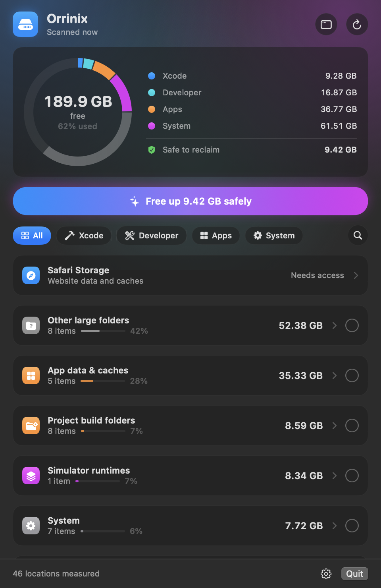
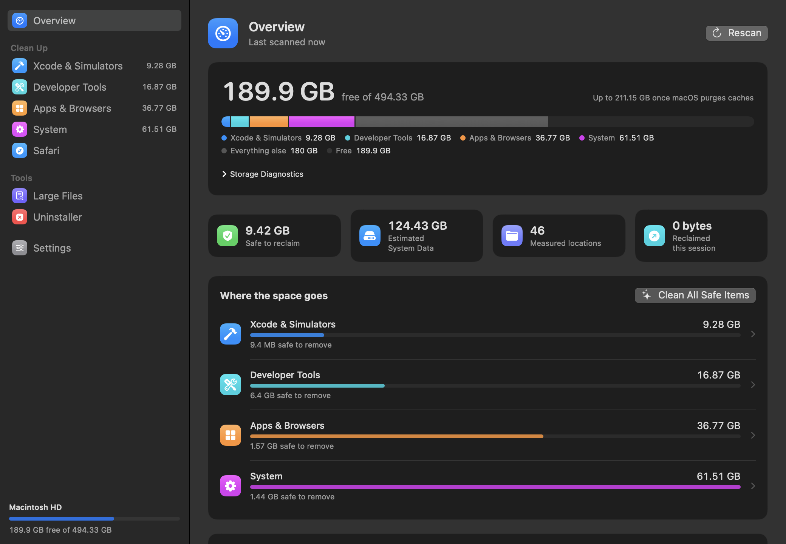

# Changelog

All notable changes to Orrinix are listed here. The format follows
[Keep a Changelog](https://keepachangelog.com/en/1.1.0/) and the project uses
[Semantic Versioning](https://semver.org/).

## [Unreleased]

The next release (1.1.0). Build from source to try it today.

  
  

### Added

- **Redesigned menu bar panel.** A ring gauge shows the disk split into
  Xcode, Developer, Apps and System, with free space in the centre and a
  legend that filters the list. A single **Free up X GB safely** button
  selects everything that regenerates on its own. Section chips and a search
  toggle replace the always-visible filter field.
- **Full window** (**Open Orrinix** in the panel): Overview, one cleanup page
  per section with search, a Safe / Review / Manual filter and sorting,
  Safari, Large Files, Uninstaller and Settings. The app shows a Dock icon
  while the window is open.
- **Large Files.** Finds big files in Downloads, Desktop, Documents, Movies,
  Music or any folder you add, filtered by size, by how long since you last
  opened them, and by kind (installers, archives, videos, disk images).
  Selected files go to the Trash.
- **Uninstaller.** Removes an app together with its caches, preferences,
  sandbox and group containers, saved state, web storage, login items,
  background services and privileged helpers. Files matched by the app's
  name rather than its bundle identifier start unticked. A second tab finds
  leftovers of apps that are already gone.
- **Xcode deep clean.** DerivedData per project, with projects that no
  longer exist flagged as orphaned; DeviceSupport per OS version; each
  archive by name, version and build; SwiftUI preview, Interface Builder and
  playground devices; documentation; Xcode Cloud products; xcodebuild and
  Instruments caches.
- **Simulators.** Devices unused for 60 days or more can be deleted outright.
  Each runtime shows how many simulators depend on it.
- **Browsers.** Disk, code, GPU and service-worker caches for Chrome, Edge,
  Brave, Arc, Vivaldi, Opera and Chromium across every profile, and the
  Firefox cache. Cleaning refuses while the browser is open.
- **Code editors & IDEs.** Caches, logs and workspace storage for VS Code,
  VS Code Insiders, Cursor, Windsurf and VSCodium; JetBrains caches per
  product version and settings of superseded versions.
- **Chat & meeting apps.** WhatsApp media, Telegram media cache, Messenger
  and Webex caches, alongside Slack, Discord, Teams and Zoom.
- **Settings** lists hidden items so each can be brought back on its own.
- Right-click menu on every row: Show largest entries, Reveal in Finder,
  Copy Path, Select, Hide and Delete.
- `--window` launch flag, and `--page`, `--light` and `--assume-access`
  options for `--screenshot`, used to make the README images.

### Changed

- New look throughout: tinted category icons, size bars, round selection
  marks with a partial state per category, and row actions that appear on
  hover.
- The Full Disk Access notice in the panel is a single compact line.
- Launch at login and simulator shutdown moved into the panel's gear menu
  and the Settings page.

### Fixed

- Deleting a simulator runtime no longer stops at CoreSimulator's
  "Removed the runtime, but did not reclaim its MobileAsset" error
  (SimDiskImageError 30). Orrinix runs `simctl runtime scan-and-mount` and
  deletes the runtime again, as the error suggests.
- The Safari total is now the sum of its parts. It could read 52 MB while
  website data and caches added up to several gigabytes, because the
  container root is unreadable under macOS app-data protection.
- Turkish translations for every interface string, including Safari strings
  that were previously shown in English.

## [1.0.2] - 2026-09-12

### Fixed

- Free space uses authoritative APFS physical-free capacity and is never
  mixed with the System Data estimate.
- The reclaimable estimate is derived from macOS availability hints without
  double counting.
- SIP-protected Apple daemon caches are skipped, while accessible system
  cache children are still cleaned, so cleanup no longer surfaces raw
  "Operation not permitted" errors.

## [1.0.1] - 2026-09-07

### Added

- Storage dashboard with Free now, Potentially reclaimable, grouped cleanup
  locations, search and largest-entry breakdowns, using Liquid Glass on
  macOS 26.
- Safari Storage Cleaner for website data, caches, LocalStorage, IndexedDB,
  CacheStorage and oversized SQLite WAL files, limited to an allow-list.
- Safe, Review and Manual badges, Trash-first deletion for Review items,
  batch cleanup, Select safe and hidden items.

### Fixed

- Reclaimed this session reports the actual change in free space.
- Docker data is no longer counted twice by the catch-all scan.
- Safari cleanup validates canonical paths, blocks symlink escapes, quits
  Safari before changing anything and rescans afterwards.

## [0.3.5] - 2026-09-07

### Changed

- Security and notarization policy documented; release signing requires an
  unambiguous Developer ID identity.

## [0.3.4] - 2026-09-06

### Added

- First Orrinix release: the menu bar storage inventory with probes for
  simulators, Xcode, package managers, developer tools, logs, Docker,
  virtual machines, backups, app data and a catch-all for large folders;
  faster simulator shutdown at power off; Turkish localization; and
  `Orrinix --json`.

[Unreleased]: https://github.com/Abbasm234/orrinix/compare/v1.0.2...HEAD
[1.0.2]: https://github.com/Abbasm234/orrinix/compare/v1.0.1...v1.0.2
[1.0.1]: https://github.com/Abbasm234/orrinix/releases/tag/v1.0.1
[0.3.5]: https://github.com/Abbasm234/orrinix/commits/546f825
[0.3.4]: https://github.com/Abbasm234/orrinix/commits/0dd014b
