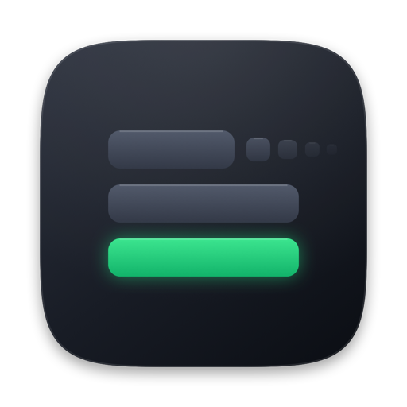
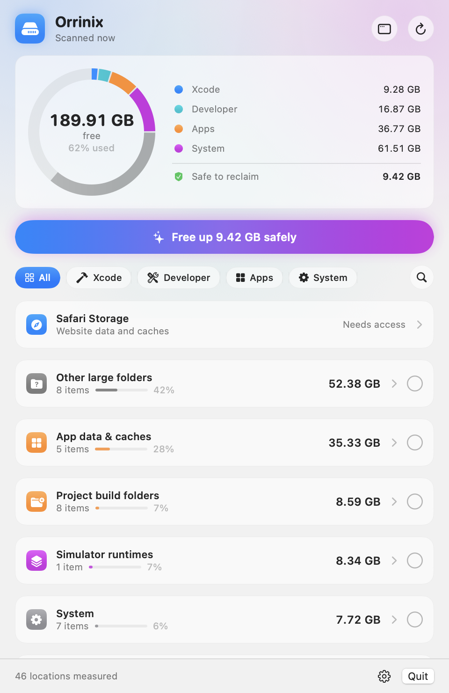

<p align="center">
  
</p>

<h1 align="center">Orrinix</h1>

<p align="center">
  Storage clarity for Mac — inspect the storage macOS may group as "System Data" and reclaim space, item by item.<br>
  
  
  <a href="LICENSE"></a>
</p>

<p align="center">
  
  &nbsp;
  
</p>

<p align="center"><sub>The menu bar panel: the disk as a ring, one-tap safe cleanup, and every category one click away.</sub></p>

<p align="center">
  
</p>

<p align="center"><sub>The full window, for deeper work: per-section cleanup, a large-file finder and an app uninstaller.</sub></p>

---

Open System Settings > General > Storage on a developer Mac and "System
Data" is often the largest line, with no way to see inside it. Finder puts
everything it cannot attribute to an app, photos or documents in that bucket:
simulator runtimes, Xcode symbol caches, package-manager stores, virtual
machine disks, the unified log, per-app data folders.

This app opens the bucket. It is not a cache cleaner: `~/Library/Caches` is
one small line among fifty, and the app never deletes anything you did not
click.

Built for Mac users who want clear answers before they clean.

Orrinix lives in the menu bar. The panel shows the disk as a ring split
into Xcode, developer tools, apps and system data, offers a single **Free up
X GB safely** button for everything that regenerates on its own, and filters
the list by section with one click. Rows stay quiet until the pointer is on
them; right-click any row for Reveal, Copy Path, Hide or Delete.

**Open Orrinix** opens the full window for deeper work:

- **Overview** with a storage bar, totals per section and the largest items.
- **Xcode & Simulators, Developer Tools, Apps & Browsers, System**: every
  category with search, a Safe / Review / Manual filter and sorting.
- **Safari** storage cleaning with a strict allow-list.
- **Large Files**: big files in Downloads, Desktop, Documents, Movies, Music
  or any folder you add, filtered by size, by how long since you last opened
  them, and by kind (installers, archives, videos, disk images).
- **Uninstaller**: removes an app together with its caches, preferences,
  containers, login items and helpers, and finds leftovers of apps you
  already deleted. Everything goes to the Trash first.
- **Settings**: launch at login, simulator shutdown, Full Disk Access status
  and the items you chose to hide.

## Install

Build from source (Xcode 26 or later):

The downloadable `v1.0.2` release predates the full window and the
redesigned panel; build from source to get them. Use Xcode 26 or later.

```bash
git clone https://github.com/Abbasm234/orrinix.git
cd orrinix
scripts/build-app.sh
open build/Orrinix.app
```

Search sits behind the magnifying glass next to the section chips; **Launch
at login** and simulator shutdown live in the gear menu and in Settings.

## What it does

- **Measured inventory.** The icon shows storage locations Orrinix found; it
  is a useful cleanup total, not a promise to exactly match macOS Storage's
  **System Data** category. The dashboard shows how much of it is safe to
  free right now. It scans on launch and once a day.
- **Every item has a real size**, measured on disk, plus a badge:
  **Safe** regenerates automatically, **Review** costs you something (a
  simulator, a login, a re-download), **Manual** cannot be removed by the app
  and the info button shows the command or settings path.
- **Trash first.** Review items go to the Trash, so a wrong click can be
  undone for 30 days. Empty the Trash to actually release those bytes. Safe
  items are deleted outright because they come back on their own. The
  **Reclaimed this session** total only increases once macOS reports the
  space as free.
- **Breakdown.** Click a row to see its five largest entries before deciding.
- **Batch delete.** Tick rows and use **Delete N selected**; every root
  action in the batch is folded into one script, so the administrator
  password is asked once. **Select safe** ticks everything regenerable.
- **Hide.** The eye button removes an item from future scans (Ollama models
  you want to keep, say). Settings lists hidden items and brings them back
  one by one.
- **Free now is physical filesystem space.** Potentially reclaimable APFS
  capacity is shown separately when macOS exposes it; it is never blended into
  the primary Free value.
- **Safari Storage Cleaner.** A dedicated card measures Safari WebsiteData,
  caches, and oversized WebKit SQLite WAL files without offering the Safari
  container itself for deletion. It recommends a single website origin when
  that origin dominates the storage, quits Safari only after confirmation,
  validates every cleanup path against a hardcoded allow-list, and rescans to
  show before/after/recovered space. Website cleanup can sign you out and
  remove offline website data; bookmarks, History, profiles, saved passwords,
  and iCloud Keychain are never targeted.
- **Faster shutdown.** A booted iOS simulator ignores the quit request and
  makes macOS wait 33 seconds before killing it (`launchd`: "Service did not
  exit 33 seconds after SIGTERM"). Because the app is running at power off,
  it shuts every simulator down the moment the shutdown starts and only
  quits once that is done. Switch in the footer, on by default. Measured on
  a MacBook Air with three simulators booted: userspace teardown went from
  33,074 ms to 5,842 ms, the remaining 5 s being macOS's own service timeout.
  Check your own numbers after a restart with
  `grep "Userspace teardown took" /var/log/com.apple.xpc.launchd/launchd.log.2`.
- **Turkish** interface, following the system language.
- **`Orrinix --json`** prints the whole inventory for scripts.

## What it finds

| Category | Items | Badge |
| --- | --- | --- |
| Time Machine snapshots | local APFS snapshots (`tmutil`) | Safe |
| Simulator devices | per-device caches, unavailable devices, devices unused for 60+ days, erase a device; the system dyld cache is reported (macOS blocks deleting it, even as root) | Safe / Review / Manual |
| Simulator runtimes | each installed runtime disk image, with how many simulators use it; deletion retries automatically when CoreSimulator leaves its MobileAsset behind | Review |
| Xcode | DerivedData per project (projects that no longer exist are flagged), DeviceSupport per OS version, each archive by name and version, SwiftUI preview, Interface Builder and playground devices, documentation, Xcode Cloud products, xcodebuild and Instruments caches, inactive Xcode.app copies | Safe / Review |
| Package managers | brew, npm, pnpm, yarn, pip, uv, CocoaPods, Gradle, Cargo, SwiftPM, Go, Cypress, Playwright; the whole Homebrew prefix | Safe / Manual |
| Developer tool data | Ollama and Hugging Face models, nvm/rustup/pyenv/rbenv/SDKMAN toolchains, conda, Maven, CocoaPods specs, Gradle distributions, Go modules, Bun, Deno, VS Code and Cursor extensions, Docker CLI, OrbStack, Lima, Colima, Claude Code; any other hidden home folder over 100 MB | Safe / Review |
| Logs & diagnostics | unified log store (`log erase`), crash reports, ASL, `~/Library/Logs` | Safe |
| Temporary files | `/private/var/folders` user cache and temp, files older than 3 days | Safe |
| Docker | Unused Docker data when Docker is running; otherwise the complete Docker Desktop container (images, containers, virtual disk, and settings) | Review |
| Virtual machines | Parallels, UTM, VMware Fusion, VirtualBox, Tart | Review |
| Trash | `~/.Trash` | Safe |
| iOS device backups | each MobileSync backup with device name and date | Review |
| Shared & other users | `/Users/Shared` app data (BlueStacks and friends), other accounts | Review / Manual |
| Android | AVD emulators, SDK system images, platforms, build tools, NDK, emulator, Android Studio caches | Review / Safe |
| Code editors & IDEs | VS Code, Insiders, Cursor, Windsurf and VSCodium caches, logs and workspace storage; JetBrains caches per product version and settings of superseded versions | Safe / Review |
| Browsers | Chrome, Edge, Brave, Arc, Vivaldi, Opera and Chromium disk, code, GPU and service-worker caches across profiles; Firefox cache. Refuses while the browser is open | Safe |
| Chat & meeting apps | Slack, Discord, Teams and Messenger caches, Zoom data, Webex, WhatsApp media, Telegram media cache | Safe / Review |
| App data & caches | Spotify, Adobe, Steam, Epic, Photos, Quick Look and Final Cut render caches; Claude VM bundles; Chrome on-device model; any Application Support / Containers / Group Containers folder over 200 MB, caches over 100 MB | Safe / Review |
| Safari Storage Cleaner | WebsiteData, LocalStorage / IndexedDB / CacheStorage, Safari caches, and abnormally large SQLite WAL files; cleanup targets only explicitly allowed child paths | Quick / Website data / Targeted |
| Project build folders | `node_modules`, `.build`, `Pods`, `DerivedData` under Desktop, Documents, Developer, Projects | Review |
| System | macOS installers, device firmware, Mail downloads, `/Library/Caches`, `/Library/Application Support`, Command Line Tools, cryptexes, Spotlight index, swap, iCloud local copies | Safe / Review / Manual |
| Other large folders | catch-all: every folder over 500 MB under `~`, `/Library`, `/private/var`, `/opt`, `/usr/local` and `/Users/Shared` that no category above explains, shown with its full path | Review |

The catch-all pass runs last and takes the longest (it walks the home folder
once). The header shows which phase the scan is in. Folders Finder attributes
to Photos, Music, Movies, Messages, Mail, iCloud Drive and Applications are
skipped because they are not System Data.

## Permissions, once

Two things can prompt, and both can be settled one time:

- **Folder access.** macOS asks per protected folder (Desktop, Documents,
  Downloads, …) and silently hides Mail, Safari and Time Machine data. Grant
  **Full Disk Access** to the app in System Settings > Privacy & Security
  instead; the app shows a banner with a button until that is done. macOS
  quits the app when the grant is toggled, so reopen it afterwards. The grant
  is remembered by code-signing identity, which is why `scripts/build-app.sh`
  signs with your Developer ID or Apple Development certificate when one is
  in the keychain. An ad-hoc signature changes on every build and macOS would
  forget the grant each time. Override with `CODESIGN_IDENTITY="..."`.
- **Administrator password.** Needed for root actions. Batch them to be
  asked once per batch. Avoiding the prompt entirely would require a
  privileged helper daemon, which is deliberately out of scope for a small
  tool.

## Scripting

```bash
/Applications/Orrinix.app/Contents/MacOS/Orrinix --json > inventory.json
jq '.items[] | select(.safety == "safe") | [.name, .sizeBytes]' inventory.json
```

The output has `totalBytes`, `usedBytes`, `physicalFreeBytes`, optional
`importantUsageAvailableBytes`, `opportunisticAvailableBytes` and
`estimatedReclaimableBytes`, plus the measured category estimate and one
record per item with `id`, `category`, `name`, `detail`, `sizeBytes`, `safety`,
`manual` and `path`. See [`docs/storage-accounting.md`](docs/storage-accounting.md)
for the semantics of each metric.

For development, `script/build_and_run.sh run --window` builds, launches and
opens the full window. `Orrinix --screenshot out.png` renders the panel
offscreen after a real scan; add `--page overview` (or `xcode`, `developer`,
`apps`, `system`, `safari`, `largefiles`, `uninstaller`, `settings`) for a
window page, `--light` for the light appearance and `--assume-access` to
leave out the Full Disk Access banner. The README images are made this way.

`sysdata` is a bash script covering the Safe categories only, for machines
where you would rather not run an app:

```bash
./sysdata              # scan
./sysdata clean        # dry run
./sysdata clean --yes  # apply
```

## How it works

`Sources/Orrinix/Probes` holds one `StorageProbe` per category. Each
probe measures its locations with a single filesystem enumeration
(allocated blocks, no symlink traversal, the same numbers Finder uses) and
returns `StorageItem`s with a name, a size, a safety level and a
`ReclaimAction`: remove paths, empty directories, prune by age, run a tool's
own clean command, or run a script as root through the system authorization
dialog. Probes never mutate anything; `Reclaimer` is the only place that
deletes.

The catch-all probe receives every path the other probes claimed and reports
whatever large folder is left, so the inventory stays complete on machines
with software the app has never heard of. Adding a category means adding one
probe and registering it in `ProbeRegistry`.

Interface strings live in `Resources/Localizable.xcstrings`;
`scripts/compile-strings.sh` turns the catalog into the `.lproj` tables
SwiftPM ships, and a test checks that every key has a Turkish translation.

## Releasing

For a production direct-distribution build, use the Developer ID + notarization
workflow. It verifies the signature, Hardened Runtime, nested code, stapled
ticket and Gatekeeper before creating the final ZIP:

```bash
scripts/notarize-release.sh
```

The final artifact is `dist/Orrinix-vVERSION-macOS.zip` with a matching SHA-256
file. It requires a Developer ID Application certificate and an
`OrrinixNotary` Keychain profile; see [`docs/releasing.md`](docs/releasing.md).

To also bump `VERSION`, commit, tag, push, publish the GitHub release, and
update the Homebrew cask:

```bash
scripts/release.sh          # patch
scripts/release.sh minor
```

It expects `gh` to be logged in, a configured Homebrew tap, and the same
notarytool Keychain profile.

## Requirements

macOS 14 or later. Xcode 26 or later to build. Xcode command line tools for
the simulator and Xcode categories; other tools are optional and skipped when
absent.

## License

MIT. This customized version is branded, maintained, and published by
**Abbas Muhammad** as Orrinix. It incorporates MIT-licensed upstream work;
the original copyright notice is preserved in `LICENSE` as required by the
license terms.
